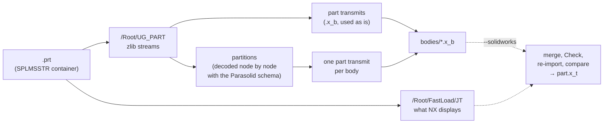

# nx2parasolid

**Get exact solid geometry out of Siemens NX `.prt` files without NX.**

[](https://github.com/Hat000/nx2parasolid/actions/workflows/ci.yml)


[](LICENSE)

`nx2parasolid` reads the part file directly and writes the **exact B-rep** NX stores inside it as
standard Parasolid (`.x_b` / `.x_t`), which SolidWorks, Solid Edge, NX, Onshape, Fusion and most
other CAD systems open. Not a remesh software. The surfaces, edges and
tolerances in the output are bit-for-bit the ones inside NX.

```text
$ nx2parasolid convert parts/ -o converted/
12:01:04 BRACKET-01: 9 Parasolid streams -> 6 files in bodies/ (6 bodies), 0 faceless skipped
12:01:04 SOCKET-05: 16 Parasolid streams -> 12 files in bodies/ (19 bodies), 0 faceless skipped
...
12:01:18 done: 36 file(s), 28 with geometry, 0 error(s) -> converted/
```

* **Exact** NX's own Parasolid data is copied byte-for-byte.
* **Offline and private** 
* **Verfication** Every body it writes is decoded again and its topology counted with the
  optional SolidWorks backend every part is merged, checked, re-imported and compared body by
  body.
* **Limitiations** It stops on data that are encrypted, which bodies it
  could not extract and why, and marks every result that requires review.

## Install

```bash
pip install git+https://github.com/Hat000/nx2parasolid
```

Python 3.9+ on Windows, macOS or Linux. No third-party packages.

## Use

```bash
nx2parasolid info  BRACKET-01.prt            # what's inside: streams, bodies, surfaces, components
nx2parasolid tree  ASSEMBLY.prt              # assembly structure, flags missing part files
nx2parasolid convert parts/ -o converted/    # every .prt in a folder -> Parasolid
nx2parasolid convert BRACKET-01.prt -o out/ --solidworks   # one merged, checked .x_t per part
nx2parasolid preview BRACKET-01.prt          # save the embedded thumbnail
nx2parasolid schemas                         # which Parasolid schema files were found
```

`info` on a single part:

```text
UPPER-ARM-L.prt  (1.5 MB, SPLMSSTR container, 14 streams)
  Parasolid: 4 deltas, 8 part, 4 partition   schema SCH_3801167_38101_13006
  Bodies:    19 with faces (384 faces), 0 construction (no faces)
  Surfaces:  cylinder 198, plane 170, torus 16
  Displayed by NX: 43 shapes
  Uses:      BRACKET-02, SPHERICAL-BEARING, HEX-NUT, ROD-END
```

`tree` on an assembly resolves every child to a `.prt` next to it and tells you what is missing
*before* you discover it in CAD:

```text
SUSPENSION-L
  - DAMPER
  - FRONT-L
    - UPPER-ARM-L
      - LINK-STUB-02  [file missing]
      - SPHERICAL-BEARING
...
1 referenced part file(s) not found: LINK-STUB-02
```

### Output

For each part, `converted/<part>/` holds:

| Path | What |
|---|---|
| `bodies/*.x_b` | One Parasolid file per source: NX's own part transmits unchanged, plus every body that existed only in NX's partition store, as a stand-alone part. Faceless construction bodies (points, wires) are left out. Opens in any Parasolid-based CAD. |
| `raw/` | Every Parasolid stream exactly as stored in the `.prt` (`.x_b` part, `.p_b` partition, `.d_b` undo history). |
| `<part>.x_t`, `<part>.SLDPRT` | With `--solidworks`: all bodies of the part merged into one file. |
| `manifest.json` | Everything found, every body's face count and surface census, what was skipped and why, and the verification numbers. |

### `--solidworks`: one checked file per part (Windows)

With SolidWorks installed, `--solidworks` measures every body, drops exact duplicates (NX keeps
WAVE-linked copies of bodies from other parts), keeps the bodies **NX itself displays for that
part** (matched against NX's lightweight display data), merges them into one part, runs
SolidWorks Check, exports `<part>.x_t`, re-imports it and compares every body:

```text
12:04:20 UPPER-ARM-L: 18 bodies measured, 18 distinct, 17 kept (displayed by NX)
12:04:50 UPPER-ARM-L: PASS  bodies 17/17, Check faults 0, worst rel. volume 1.5e-08, area 2.9e-10, centre of mass 1.1e-06 mm
```

`PASS` needs the same body count, zero Check faults and volume/area within 1e-5 per body.
Anything else is reported as `CHECK` with the numbers, so you can look. `--all-bodies` keeps
every distinct body instead of only the displayed ones.

### Python

```python
from nx2parasolid import convert_prt, SchemaStore

result = convert_prt("BRACKET-01.prt", "out/BRACKET-01", SchemaStore())
for f in result.files:
    print(f.file, [b["faces"] for b in f.bodies])
```

## The one requirement: Parasolid schema files

A Parasolid binary file only records how its layout *differs* from a base schema
(`sch_13006.s_t` and friends). To decode the bodies NX keeps in its partition store,
`nx2parasolid` needs those schema files. **They are not included here** - they are part of the
Parasolid runtime that Parasolid-based CAD systems install, and are found automatically in:

* `--schema-dir DIR` or the `NX2PARASOLID_SCHEMA_DIR` environment variable
* `P_SCHEMA` (Parasolid's own convention)
* SolidWorks / eDrawings (`<install>\data\pschema`) and common Parasolid locations

Without them, `nx2parasolid` still copies every part transmit NX stored (often most of the
geometry) and tells you which bodies it could not extract.

## How it works



The details of each layer - the container directory, the transmit encoding, the schema-edit
codes, how a partition body is turned into a part, and how NX's display list is read - are
written up in [docs/FORMAT.md](docs/FORMAT.md).

## Validation

Developed and validated on a real 36-file racing-car suspension assembly saved by NX 2206 to
NX 2606 (Parasolid v37-v38):

* 330 Parasolid streams found; 278 geometry streams decoded node-by-node to the terminator.
* 28 parts with geometry -> 254 body files; 24 point/wire construction bodies skipped.
* Every output loads in SolidWorks with **0 Check faults**. Merged parts: **27 PASS, 1 CHECK**
  (one bracket's volume drifts 0.11 mm³ / 2.6e-5 in SolidWorks' own `.x_t` round trip; its area
  matches to 4e-7 and its surface deviation is <= 0.5 µm).
* Independent geometric check: 8 of the 10 suspension hard points in the design notes lie on
  bolt-hole and bearing-bore axes of the converted parts to 0.000 mm (the other two point to
  parts not in the folder, or to a typo in the notes).

That is one project. Other NX versions may use encodings this hasn't met yet - see below.

## Limitations

* **Parts, not assemblies.** Component placements are stored in NX's own object data, which is
  not decoded. Parts NX models in assembly coordinates come out in place; standard parts come out
  in their own frame. `tree` lists the structure (each child once, without quantities).
* **No feature history.** You get exact solid/sheet bodies (like STEP), not NX features,
  sketches, PMI or drawings.
* **Reference sets are not read.** NX can hide stale or linked bodies through reference sets;
  `--solidworks` keeps what NX displays, which is usually right but not always. Check
  `manifest.json`.
* **Tested on NX 2206-2606.** Older files (e.g. with a tag byte before each zlib stream) are
  expected to work; anything else is untested. Bug reports welcome.

## Responsible use

* `nx2parasolid` reads data that NX stores **unencrypted**. It does not bypass licensing,
  encryption or any protection measure, and it stops if the model data is not plain zlib.
* Use it only on files you have the right to use, and respect the terms under which they were
  created (for example, NX Student Edition data is licensed for educational use).
* The Parasolid binary layout is documented by Siemens in the public *Parasolid XT Format
  Reference*; this project implements a reader and writer for it for interoperability. It ships
  no Siemens code or data. Parasolid, NX and Siemens are trademarks of Siemens Industry
  Software; SolidWorks is a trademark of Dassault Systèmes. This project is not affiliated with
  either.

## Contributing

Issues and pull requests are welcome - especially reports from NX versions other than 2206-2606.
**Please don't attach CAD files you aren't free to share.** The output of
`nx2parasolid info --json your.prt` plus the full error message is usually enough to start.

```bash
git clone https://github.com/Hat000/nx2parasolid && cd nx2parasolid
python -m pip install -e ".[dev]"
python -m pytest && python -m ruff check .
```

The test suite builds synthetic `.prt` files and Parasolid transmits from scratch
(`tests/synth.py`), so it needs no CAD system and no real CAD data.

## License

[MIT](LICENSE)
