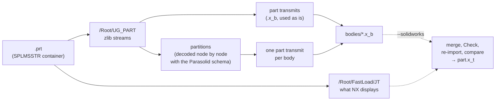

# nx2parasolid

Converts the solid and sheet bodies in Siemens NX `.prt` files to Parasolid, without NX.

[](https://github.com/Hat000/nx2parasolid/actions/workflows/ci.yml)


[](LICENSE)

An NX part file stores its geometry as Parasolid data. `nx2parasolid` reads that data from the
`.prt` and writes it out as standard Parasolid files (`.x_b` / `.x_t`), which SolidWorks, Solid
Edge, NX, Onshape, Fusion and most other CAD systems can open. The output has the same surfaces,
edges and tolerances as the NX model, since the tool copies the B-rep instead of meshing it and
fitting new surfaces.

It is meant for cases where you have NX part files but no NX to export them from, or where your
CAD system's NX importer doesn't support the NX version the files were saved in. It runs locally,
so the files are never uploaded anywhere.

```text
$ nx2parasolid convert parts/ -o converted/
12:01:04 BRACKET-01: 9 Parasolid streams -> 6 files in bodies/ (6 bodies), 0 faceless skipped
12:01:04 SOCKET-05: 16 Parasolid streams -> 12 files in bodies/ (19 bodies), 0 faceless skipped
...
12:01:18 done: 36 file(s), 28 with geometry, 0 error(s) -> converted/
```

What it does:

* Copies the Parasolid part transmits NX stored in the file unchanged. Bodies that NX keeps only
  in its partition store are written out as separate part files; their field values are copied
  as decoded, and only the internal node numbering changes.
* Runs in pure Python with no dependencies and no network access. It never writes to the input
  file.
* Decodes every body file it writes a second time and counts its topology. With the optional
  SolidWorks backend, it also merges each part, runs SolidWorks Check, re-imports the result and
  compares it body by body.
* Stops if the model data looks encrypted. It lists any bodies it could not extract, with the
  reason, and marks results that need a manual check.

## Install

```bash
pip install git+https://github.com/Hat000/nx2parasolid
```

Python 3.9+ on Windows, macOS or Linux. No third-party packages.

## Use

```bash
nx2parasolid info  BRACKET-01.prt            # what's inside: streams, bodies, surfaces, components
nx2parasolid tree  ASSEMBLY.prt              # assembly structure, flags missing part files
nx2parasolid convert parts/ -o converted/    # every .prt in a folder -> Parasolid
nx2parasolid convert BRACKET-01.prt -o out/ --solidworks   # one merged, checked .x_t per part
nx2parasolid preview BRACKET-01.prt          # save the embedded thumbnail
nx2parasolid schemas                         # which Parasolid schema files were found
```

`info` on a single part:

```text
UPPER-ARM-L.prt  (1.5 MB, SPLMSSTR container, 14 streams)
  Parasolid: 4 deltas, 8 part, 4 partition   schema SCH_3801167_38101_13006
  Bodies:    19 with faces (384 faces), 0 construction (no faces)
  Surfaces:  cylinder 198, plane 170, torus 16
  Displayed by NX: 43 shapes
  Uses:      BRACKET-02, SPHERICAL-BEARING, HEX-NUT, ROD-END
```

`tree` on an assembly looks for each child's `.prt` in the assembly's folder and lists the ones
it can't find:

```text
SUSPENSION-L
  - DAMPER
  - FRONT-L
    - UPPER-ARM-L
      - LINK-STUB-02  [file missing]
      - SPHERICAL-BEARING
...
1 referenced part file(s) not found: LINK-STUB-02
```

### Output

For each part, `converted/<part>/` holds:

| Path | What |
|---|---|
| `bodies/*.x_b` | One Parasolid file per source: NX's own part transmits unchanged, plus every body that existed only in NX's partition store, as a stand-alone part. Faceless construction bodies (points, wires) are left out. Opens in any Parasolid-based CAD. |
| `raw/` | Every Parasolid stream exactly as stored in the `.prt` (`.x_b` part, `.p_b` partition, `.d_b` undo history). |
| `<part>.x_t`, `<part>.SLDPRT` | With `--solidworks`: all bodies of the part merged into one file. |
| `manifest.json` | Everything found, every body's face count and surface census, what was skipped and why, and the verification numbers. |

### `--solidworks`: one checked file per part (Windows)

With SolidWorks installed, `--solidworks` measures every body and drops exact duplicates (NX
keeps WAVE-linked copies of bodies from other parts). It then keeps the bodies NX displays for
that part, found by matching them against NX's lightweight display data, merges them into one
part, runs SolidWorks Check, exports `<part>.x_t`, re-imports it and compares every body:

```text
12:04:20 UPPER-ARM-L: 18 bodies measured, 18 distinct, 17 kept (displayed by NX)
12:04:50 UPPER-ARM-L: PASS  bodies 17/17, Check faults 0, worst rel. volume 1.5e-08, area 2.9e-10, centre of mass 1.1e-06 mm
```

A part gets `PASS` when the body count matches, Check reports zero faults, and every body's
volume and area agree within 1e-5. Otherwise it gets `CHECK`, with the numbers printed.
`--all-bodies` keeps every distinct body instead of only the displayed ones.

### Python

```python
from nx2parasolid import convert_prt, SchemaStore

result = convert_prt("BRACKET-01.prt", "out/BRACKET-01", SchemaStore())
for f in result.files:
    print(f.file, [b["faces"] for b in f.bodies])
```

## Parasolid schema files

A Parasolid binary file records only how its layout differs from a base schema
(`sch_13006.s_t` and similar). `nx2parasolid` needs those schema files to decode the bodies NX
keeps in its partition store. This repository doesn't include them. They come with the Parasolid
runtime that Parasolid-based CAD systems install, and the tool looks for them in:

* `--schema-dir DIR` or the `NX2PARASOLID_SCHEMA_DIR` environment variable
* `P_SCHEMA` (Parasolid's own convention)
* SolidWorks / eDrawings (`<install>\data\pschema`) and common Parasolid locations

If no schema files are found, `nx2parasolid` still copies every part transmit NX stored, which is
often most of the geometry, and lists the bodies it could not extract.

## How it works



[docs/FORMAT.md](docs/FORMAT.md) describes each layer: the container directory, the transmit
encoding, the schema-edit codes, how a partition body is turned into a part, and how NX's display
list is read.

## Validation

The tool was developed and tested on a 36-file racing-car suspension assembly saved by NX 2206
to NX 2606 (Parasolid v37-v38):

* It found 330 Parasolid streams and decoded all 278 geometry streams to the terminator node.
* The 28 parts with geometry produced 254 body files. It skipped 24 point/wire construction
  bodies.
* Every output loads in SolidWorks with 0 Check faults. Of the merged parts, 27 passed and 1 was
  marked `CHECK`: one bracket's volume changed by 0.11 mm³ (2.6e-5) in SolidWorks' own `.x_t`
  round trip, while its area matched to 4e-7 and its surfaces deviated by at most 0.5 µm.
* 8 of the 10 suspension hard points in the team's design notes lie on bolt-hole and
  bearing-bore axes of the converted parts to within 0.000 mm. The other two refer to parts that
  weren't in the folder, or to a typo in the notes.

All of these results come from one project's files. Files from other NX versions may use
encodings the tool hasn't been tested on (see Limitations).

## Limitations

* It converts parts, not assembly placements. NX stores component positions in its own object
  data, which the tool doesn't decode. Parts modelled in assembly coordinates come out in place;
  standard parts come out in their own frame. `tree` lists the structure, with each child once
  and no quantities.
* The output contains solid and sheet bodies only, as a STEP file would. NX features, sketches,
  PMI and drawings are not converted.
* Reference sets are not read. NX can hide stale or linked bodies through reference sets.
  `--solidworks` keeps what NX displays, which is usually the right set but not always, so check
  `manifest.json`.
* It has been tested on files from NX 2206 to 2606. Older files (for example, with a tag byte
  before each zlib stream) should work but haven't been tested.

## Responsible use

* `nx2parasolid` reads data that NX stores unencrypted. It does not bypass licensing, encryption
  or any other protection, and it stops if the model data is not plain zlib.
* Use it only on files you have the right to use, and respect the terms under which they were
  created (for example, NX Student Edition data is licensed for educational use).
* Siemens documents the Parasolid binary layout in the public *Parasolid XT Format Reference*.
  This project implements a reader and writer for it for interoperability and ships no Siemens
  code or data. Parasolid, NX and Siemens are trademarks of Siemens Industry Software; SolidWorks
  is a trademark of Dassault Systèmes. This project is not affiliated with either.

## Contributing

Issues and pull requests are welcome, especially reports from NX versions other than 2206-2606.
Please don't attach CAD files you aren't free to share. The output of
`nx2parasolid info --json your.prt` and the full error message are usually enough to start with.

```bash
git clone https://github.com/Hat000/nx2parasolid && cd nx2parasolid
python -m pip install -e ".[dev]"
python -m pytest && python -m ruff check .
```

The test suite builds synthetic `.prt` files and Parasolid transmits from scratch
(`tests/synth.py`), so it needs no CAD system and no real CAD data.

## License

[MIT](LICENSE)
